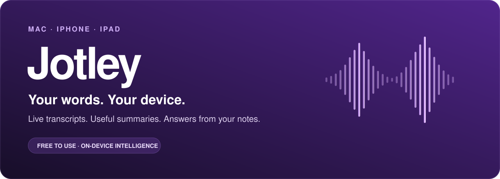
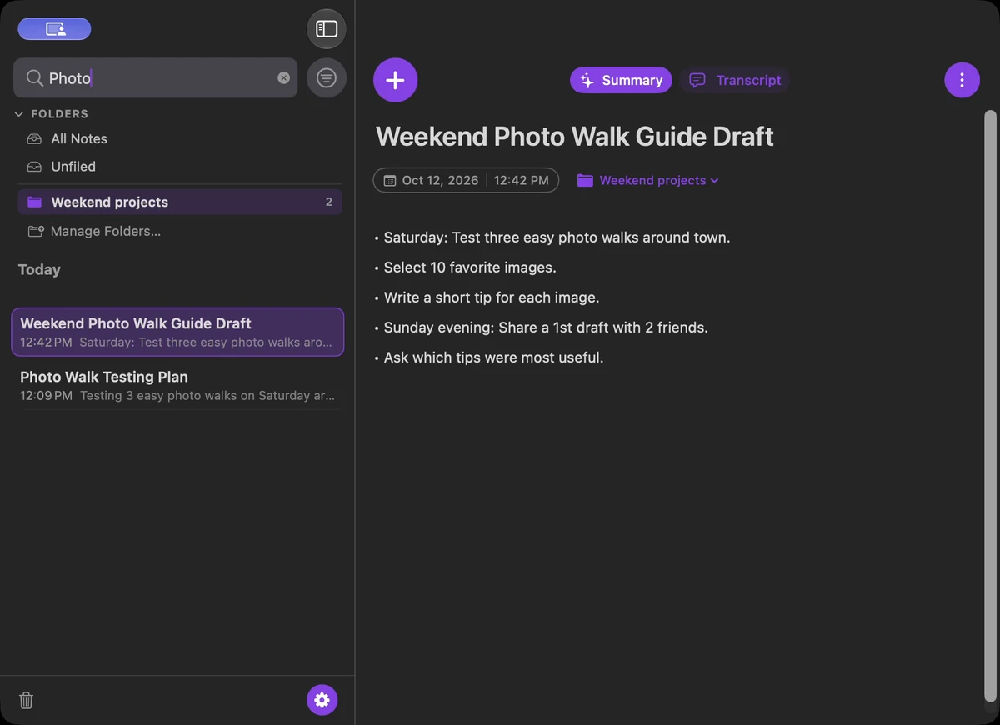
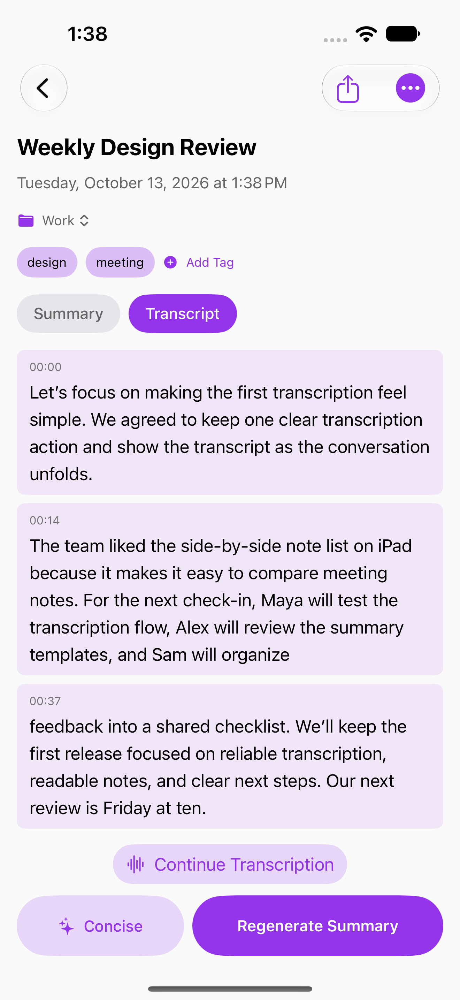
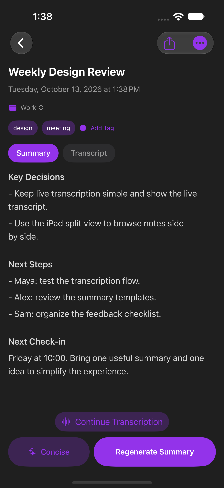
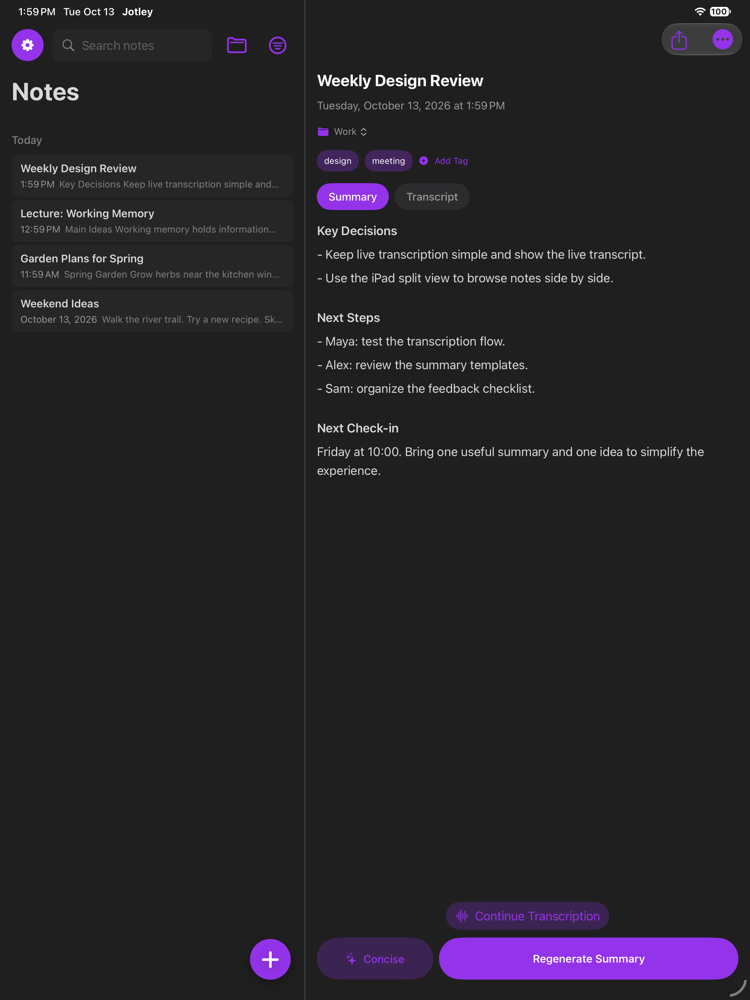

<p align="center"></p>

<p align="center"><strong>Turn conversations into clear, useful notes.</strong><br>Free native apps for Mac, iPhone and iPad. Powered by on-device Apple Intelligence.</p>

<p align="center"><a href="https://jotley.ai/download"><strong>Download for Mac</strong></a> · <a href="#build-it-yourself">Build it yourself</a> · <a href="https://jotley.ai">Visit Jotley</a></p>

---

## Speak freely. Keep what matters.

Meetings, lectures, passing ideas and long conversations: Jotley turns spoken words into searchable transcripts, helpful summaries and answers grounded in your notes.

**No account. No subscription. No remote AI service. Every feature is free.**

Long transcripts are reviewed in full, using sections sized for Apple's on-device model. Watch preparation progress, then see the summary appear as it is written. You can leave a note while it finishes. On iPhone and iPad, Jotley requests background processing time; if iOS interrupts the job, completed sections are saved locally and generation resumes when you return. Background runtime depends on system conditions.

On iPhone and iPad, tap **+** and start live transcription immediately. Watch timestamped words fill the page from the top, then follow the newest words as the transcript grows. Pause when you need to, then stop or close to save. **Continue Transcription** adds to the same note. Mobile sessions save transcript text, without saving an audio file.

On Mac, capture your microphone and audio from your apps or system. Tap + to start live transcription immediately, then keep your transcript and summary together in one familiar native workspace.



## Your notes, wherever inspiration finds you

<table>
<tr><th>iPhone · capture the moment</th><th>iPhone · find the useful parts</th></tr>
<tr><td align="center"></td><td align="center"></td></tr>
<tr><td>Live words. Clear timestamps. Continue anytime.</td><td>One useful summary, automatic titles and your choice of template.</td></tr>
</table>

### More room to think on iPad

Browse your notes beside the note you're working on. Organize a meeting, revisit a lecture, or turn an idea into a plan — with the same native tools on a larger screen.



*Native product captures use example notes. [Screenshot and artwork sources](docs/readme/README.md).*

## From spoken words to your next step

| | |
| --- | --- |
| **Make yourself at home** | Guided setup for private notes, Apple Intelligence, your transcription language and microphone access. Mac also offers separate system-audio setup. Replay it from Settings → Welcome to Jotley. |
| **Live transcription** | Start with **+** on iPhone/iPad. Timestamped cards follow new words; the waveform shows microphone input. Mac supports microphone and system audio. |
| **Summaries that finish** | Choose **Auto** or a template. Long notes become one consolidated summary. See preparation progress while sections are reviewed, then follow the summary as it is written. **Cancel Generation** stays visible; regeneration starts with one tap. |
| **Ask your notes** | On iPhone and iPad, tap **Ask AI** on the Summary tab; on Mac, use **More → Ask AI**. Find answers, pull out action items or clarify a detail using on-device Apple Intelligence. |
| **Know when it’s ready** | Optional local notifications tell you when a completed summary is saved. Alerts work offline and keep note content off the Lock Screen. |
| **Automatic topic tags** | Each completed summary replaces the note’s tags with one to five relevant topics, preferring existing library tags. Transcripts under ten words can remain untagged. |
| **Make it yours** | Edit transcripts and summaries, organize with folders and tags, search and filter, and choose light or dark appearance. |
| **Keep moving** | iPhone widgets and the Lock Screen/Dynamic Island show the active transcription session. |
| **Share your work** | Export text or Markdown, share natively, and send notes to Obsidian on Mac. |
| **Optional iCloud sync** | Pick up your notes on another device using your private iCloud database. |

## Local processing. Clear privacy.

**Transcription happens on your device using Apple's speech models. Summaries and Ask AI happen on your device using Apple Intelligence.** Jotley does not send your audio, notes, transcripts or summaries to a Jotley server or remote AI provider.

Once the Apple models are ready, these features work offline. A speech language may require a **one-time Apple model download**, which you explicitly start in Settings.

**iCloud sync is optional and on by default in configured signed builds.** If enabled, note content syncs through your private iCloud database. Raw Mac audio stays on the Mac. Turn sync off in Settings and restart to keep note content local, apart from anything you choose to export or share. Apple model setup, enabled iCloud sync and Mac update checks can use the internet.

## Ready for Apple Intelligence

| Platform | Requirements |
| --- | --- |
| **Mac** | macOS **27+**, Apple Silicon supporting Apple Intelligence |
| **iPhone** | iOS **27+**, iPhone **15 Pro/Pro Max**, **16 or later**, or **iPhone Air** |
| **iPad** | iPadOS **27+**, **M1 or later**, or iPad mini with **A17 Pro** |

Apple Intelligence must be enabled and its model ready. Transcription also needs a supported language with its separate Apple speech model installed. Hardware compatibility alone does not complete model setup.

**Jotley 2.1.2 (403) for Mac is available at [jotley.ai/download](https://jotley.ai/download), and iPhone/iPad 2.1.2 (403) is available in the Jotley Home internal TestFlight group.** The App Store submission was not changed for this release. [Watch the onboarding walkthrough](https://media.jotley.ai/clips/jotley-onboarding-main-window-20261020.mp4). You can build both apps from this source.

## Build it yourself

Use **Xcode 27**. No Jotley account, API key or private release credentials are needed for the local development builds.

```sh
git clone https://github.com/protomota/jotley.git
cd jotley
open Jotley.xcodeproj
```

Choose **Jotley** for Mac or **Jotley-iOS** for iPhone/iPad. Local builds use separate development identities and local storage. A physical iPhone/iPad needs your own Apple signing team. To enable iCloud, configure your own identifiers, container and signing credentials.

[Local build instructions and checks](docs/PUBLIC_BUILD.md) · [Third-party credits](docs/PROVENANCE.md)

## Free to use. Source available.

Use Jotley for personal work, school or paid work. Your notes, transcripts and summaries are yours.

The original code and artwork are © 2026 Protomota, LLC and use the [Jotley Source-Available License 1.0](LICENSE). You may inspect, build, modify and redistribute them noncommercially. Commercial distribution requires written permission from Protomota, LLC. This is a source-available license, rather than an OSI open-source license. Third-party code, fonts and dependencies retain their own terms.

## Made by Protomota. Supported by people.

If Jotley helps you, a **rating and review** on the [App Store](https://apps.apple.com/us/app/jotley/id6746770199) helps other people find it. Sharing the app and sending feedback help us improve it. [Optional tips](https://jotley.ai/tips) support development; every feature stays free.

[Website](https://jotley.ai) · [Support](mailto:jotly-support@protomota.com) · [Licensing](mailto:jotly-legal@protomota.com)
